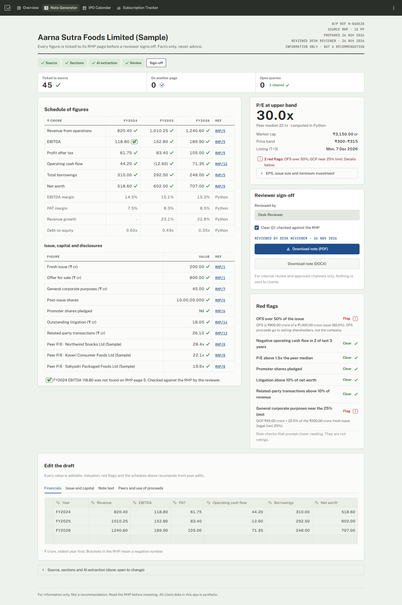
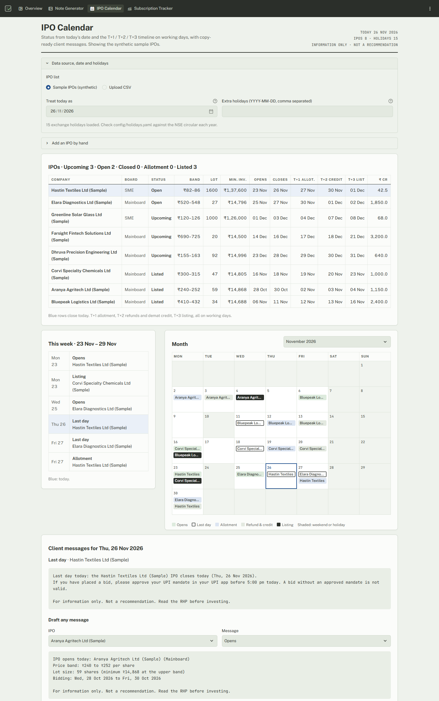
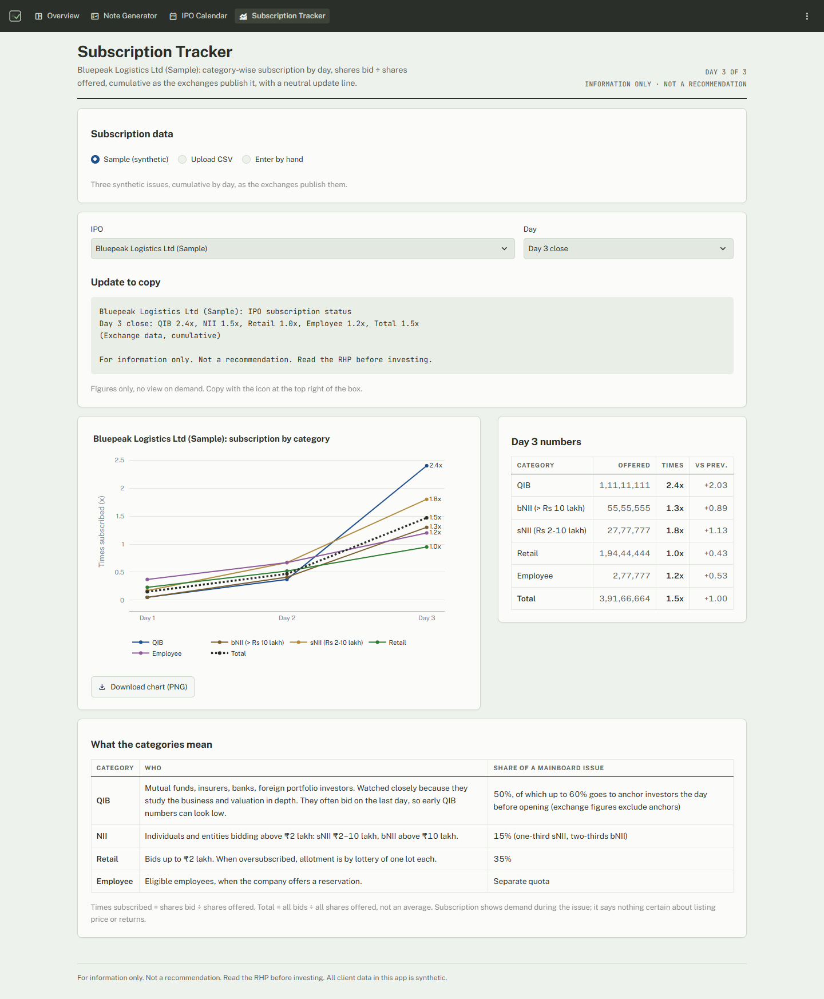
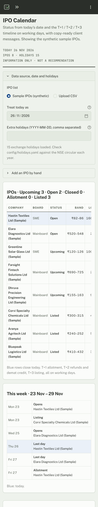
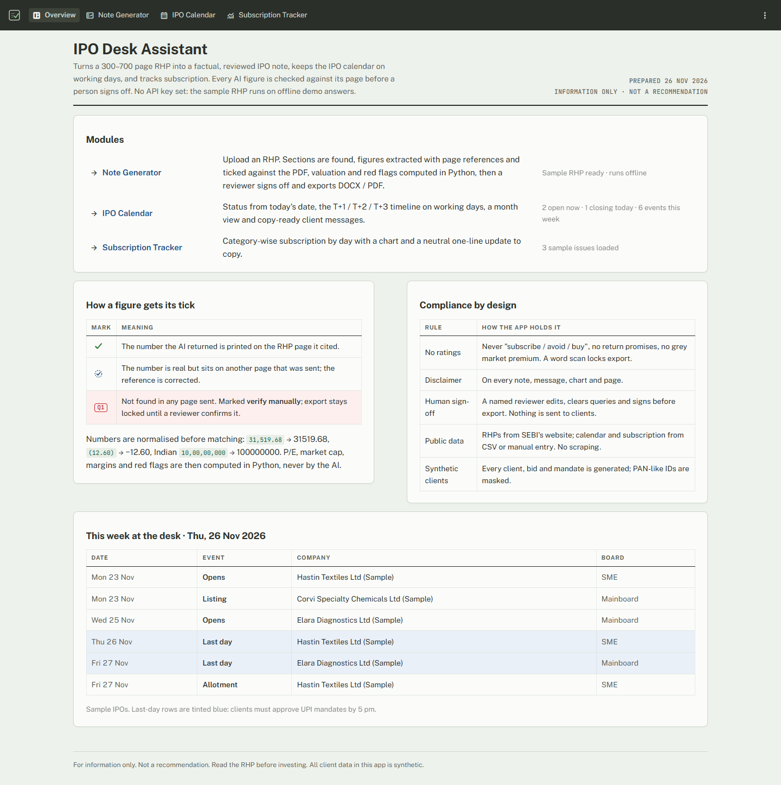
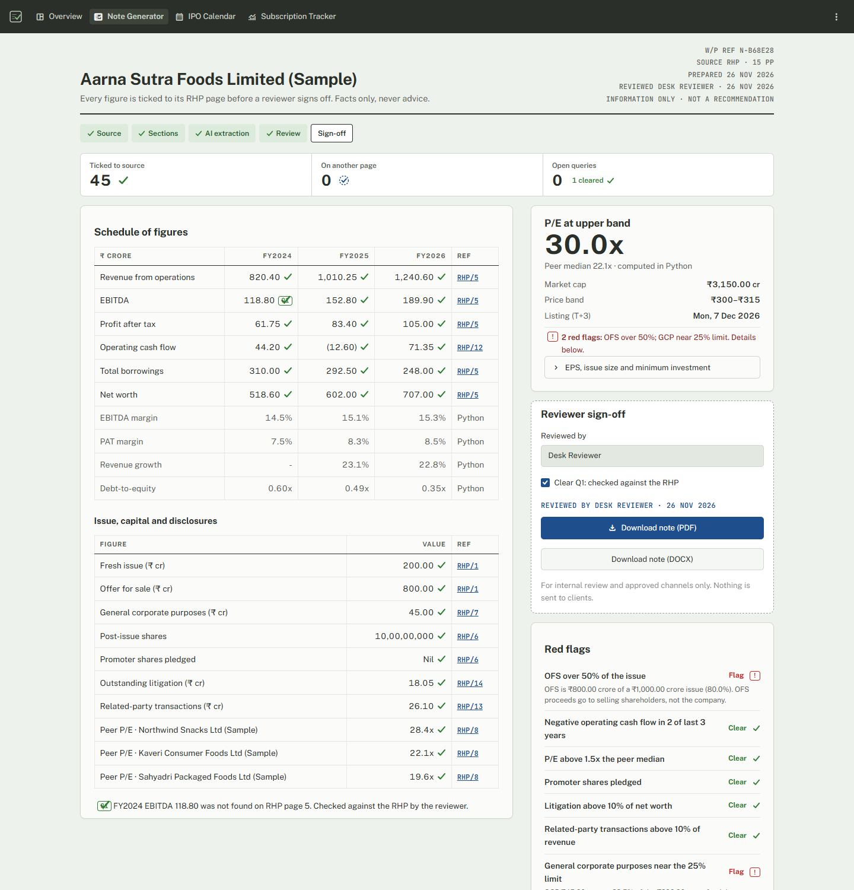
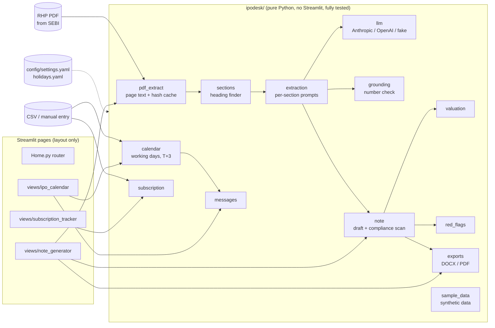

# IPO Desk Assistant

Automation for a stock broker's **Mutual Funds & IPO desk**. It turns a 300–700 page Red Herring Prospectus
(RHP) into a reviewed, factual IPO note; tracks IPO dates with a working-day T+3 timeline and drafts client
alerts; and tracks category-wise subscription.

> **For information only. Not a recommendation. Read the RHP before investing.**
> All client data in this project is synthetic.

**Live app:** https://aayushh04-ipo-desk-assistant-automation-tool-home-sys0c1.streamlit.app/

| IPO Note Generator | IPO Calendar | Subscription Tracker |
|---|---|---|
|  |  |  |

  

After sign-off: the reviewer clears query Q1 (the tick is drawn over it), the note is stamped and export unlocks.



## What it does

**1. AI IPO Note Generator**
- Reads every page of an RHP (a 729-page RHP takes about 2 seconds) and keeps page numbers.
- Finds 11 key sections by their headings (Risk Factors, Objects of the Offer, Basis for Offer Price, Capital
  Structure, Financial Information, Promoters, Litigation, Related Party Transactions, Industry, Business),
  skipping the table of contents and in-sentence mentions. Missing sections can be set by page range.
- Sends **only the relevant pages** of each section to the LLM (67 of 729 pages on a real RHP) and asks for
  **strict JSON** (pydantic schemas). Every number comes with its unit and page number.
- **Grounding check:** every number is looked up in the PDF text. Anything not found is flagged *verify manually*.
- Computes valuation **in Python**: market cap, EPS and P/E at the upper band, fresh vs OFS, growth, margins, debt-to-equity.
- Runs 7 rule-based **red flags**, each with its reason (OFS > 50%, negative operating cash flow, P/E vs peer
  median, promoter pledge, litigation, related-party transactions, general corporate purposes near the 25% limit).
- Editable review screen → reviewer sign-off → **DOCX and PDF** export.

**2. IPO Calendar and client alerts**: CSV upload, manual entry or sample data; status (Upcoming / Open /
Closed / Allotment / Listed); T+1 allotment, T+2 refunds and demat credit, T+3 listing on **working days**
(weekends and `config/holidays.yaml` skipped); month view; "this week"; four message drafts with copy buttons;
optional send to a **test** Telegram chat behind a demo switch.

**Design: "Working Papers".** The app reads like an auditor's working paper: each figure carries a green pencil tick
when it is found on its RHP page, a blue cross-reference (`RHP/106`), or a numbered red query (`Q1`) that blocks
sign-off. Graphite top bar, grey-green ground, near-white sheets, Public Sans with JetBrains Mono for references.

**3. Subscription Tracker**: category-wise (QIB, bNII, sNII, Retail, Employee, Total) subscription by day;
line chart; latest-numbers table; neutral update text such as `Day 2 close: QIB 3.4x, NII 5.1x, Retail 2.2x,
Total 3.1x`; PNG chart download; an explainer of each category.

## Architecture



The rule: **all logic lives in `ipodesk/`**, which never imports Streamlit, so it can be tested with plain
pytest. The pages only arrange widgets.

## Compliance by design

| Rule | How the app enforces it |
|---|---|
| No ratings or advice (needs SEBI Research Analyst registration) | Prompts forbid opinions; a whole-word scanner (`subscribe`, `avoid`, `buy`, `sell`, `GMP`, `listing gain`, ...) blocks export until the text is fixed or the reviewer confirms factual use. Red flags are labelled "not ratings". |
| No return promises, no grey market premium | Not in any template or prompt; banned words in `config/settings.yaml`. |
| Disclaimer everywhere | Every note (top and bottom), every client message, the subscription update and chart image carry: *For information only. Not a recommendation. Read the RHP before investing.* |
| Human in the loop | AI only drafts. Every field is editable; metrics and flags recompute from the edited numbers; export needs a named reviewer and confirmation of any unverified figure. Nothing is sent to clients. Telegram sending only goes to a test chat and only in demo mode. |
| Permitted data only | RHPs are public documents from SEBI's website (uploaded by the user). Calendar and subscription data come from CSV or manual entry. No scraping. |
| Synthetic client data | `ipodesk/sample_data.py` generates 500 bids with masked PAN-like IDs (`KP******7V`); the unmasked value is never stored. |
| Secrets | API keys come from `.env` (local) or Streamlit Secrets (cloud); both are git-ignored. |

## How the grounding check works

LLMs can produce confident numbers that aren't in the document. So the app never trusts a figure just because
the model returned it:

1. The schema forces every number to come as `{value, unit, page, quote}`.
2. `grounding.py` takes the text of the cited page and pulls out every number printed on it, normalised:
   `31,519.68` → 31519.68, `(2,725.24)` → 2725.24 (brackets mean negative), Indian `10,00,00,000` → 100000000.
3. If the model's number is on the cited page → **ok**. If it's on another page that was sent → **page corrected**.
   If it's nowhere in the text sent → **verify manually**.
4. Numbers inside summary sentences (e.g. "64% of revenue") are checked the same way.
5. Unit conversion (million / lakh → crore) and all maths happen **after** grounding, in Python.

Tested on a real 729-page RHP: a correct revenue figure → *ok*; a real number cited on the wrong page →
*page corrected*; an invented PAT → *verify manually*. The offline demo deliberately plants one wrong figure
(FY2024 EBITDA 118.80 vs 118.30 in the PDF) so you can watch it get caught.

## Run locally (Windows)

```powershell
py -3.11 -m venv .venv
.venv\Scripts\activate
pip install -r requirements.txt
copy .env.example .env          # paste ONE API key (GEMINI_API_KEY is free); the sample RHP also works offline
python -m ipodesk.sample_data   # writes sample CSVs + a fake RHP PDF to data\sample\
pytest                          # 79 tests
streamlit run Home.py
```

**Free AI option:** create a Gemini API key at Google AI Studio (aistudio.google.com) and set `GEMINI_API_KEY`. The default `provider: auto` in `config/settings.yaml` uses whichever key is set (Anthropic, OpenAI or Gemini). The free tier is rate-limited (reported at roughly 5 requests a minute and 20 a day on Flash; one note uses 8), so the app waits and retries when it hits the per-minute limit, and switches to a lighter fallback model (`fallback_models` in settings.yaml) when the main one is overloaded. Check a key with `python -m ipodesk.llm`.

**Try it with a real RHP:** SEBI website → Filings → Public Issues → pick an "RHP" → download the PDF → upload
it on the Note Generator page and enter the price band, lot size and dates from the price band advertisement.

## Project structure

```
Home.py                          entry point: page setup + top navigation (st.navigation)
views/                           overview, note_generator, ipo_calendar, subscription_tracker (layout only)
ui_common.py                     the "Working Papers" look: CSS, drawn tick/query marks, HTML helpers
static/                          self-hosted fonts (Public Sans, JetBrains Mono) and the logo mark
ipodesk/                         pdf_extract, sections, llm, schemas, extraction, grounding, note,
                                 valuation, red_flags, calendar, messages, subscription, exports,
                                 formatting, config, sample_data
config/                          settings.yaml (LLM, thresholds, banned words), holidays.yaml
tests/                           79 pytest tests incl. known-answer tests and headless page tests
PRODUCT.md                       product facts that guide design decisions
```

## Deployment

### 1. Push to GitHub
Create an empty repository on github.com (no README), then in the project folder:
```powershell
git init
git add .
git status                      # check: no .env, no .streamlit/secrets.toml, no .venv
git commit -m "IPO Desk Assistant"
git branch -M main
git remote add origin https://github.com/<your-username>/ipo-desk-assistant.git
git push -u origin main
```
`git init` starts version control, `git add .` stages files (`.gitignore` keeps secrets and caches out),
`commit` saves a snapshot, `remote add` links the GitHub repo, and `push` uploads it.

### 2. Deploy on Streamlit Community Cloud (free)
1. Go to share.streamlit.io and sign in with GitHub.
2. **Create app** → pick the repository, branch `main`, main file **`Home.py`**.
3. **Advanced settings** → Python **3.11** → in **Secrets** paste `GEMINI_API_KEY = "..."` (free) or `ANTHROPIC_API_KEY = "sk-ant-..."`. Leave it empty to run the sample RHP on offline demo answers.
4. **Deploy**. The first build installs `requirements.txt` (a few minutes). Every `git push` redeploys.

### 3. Finish the README
Replace the live link at the top with your `*.streamlit.app` URL.

## Known limits
- Section finding relies on capitalised chapter headings (standard in SEBI-format RHPs). Scanned (image-only)
  PDFs have no text layer and would need OCR.
- `config/holidays.yaml` must be checked against NSE's official holiday circular each year.
- Cloud apps sleep after inactivity; the first load can take ~30 seconds.
